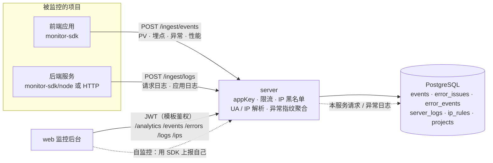

# admin-system-template · 监控后台

一个检测和展示项目运行信息的后台管理系统：**用户埋点、前端异常监控、后端日志、IP 监控、访问量（PV / UV）、页面性能**。

基于 `my-frontend-template`（React 模板）与 `my-backend-tempalte`（NestJS 模板）用各自的 `npm run create` 生成，沿用两个模板的接口契约、目录分层、鉴权、i18n、主题、测试和脚本约定。

```text
admin-system-template/
├── server/   NestJS 11 + Prisma + PostgreSQL   上报接口、统计查询、本服务日志、IP 黑名单
├── web/      React 19 + Vite + TanStack Query  监控后台页面
└── sdk/      零依赖上报 SDK                     浏览器自动采集 + Node 后端日志
```

## 数据流



## 功能

| 模块 | 能力 |
|---|---|
| 概览 | PV、UV、前端异常、受影响访客、后端请求、5xx 错误率、平均响应、平均加载，带「较上期」环比；访问 / 异常 / 请求 / 5xx 趋势；高频异常；热门页面 |
| 访问分析 | 会话、独立 IP、FCP、页面排行（PV / UV）、来源域名、浏览器 / 系统 / 设备分布 |
| 用户埋点 | `track()` 与 `data-track` 声明式埋点；事件汇总（次数、人数、最近触发）；事件明细（属性、访客、IP、设备） |
| 前端异常 | JS / Promise / 资源 / 接口 / 自定义；按指纹合并为问题；解决 / 忽略 / 重新打开，回归自动重开；堆栈、用户操作路径、环境、发生记录 |
| 后端日志 | 本服务每个请求和异常堆栈自动入库；外部服务上报；级别、状态码分布；慢接口 P95；按请求 ID 串联 |
| IP 监控 | 合并前端事件、异常、后端请求的 IP 排行；单 IP 画像；黑名单（拒收上报，403 `IP_BLOCKED`）；上报接口按 IP 限流 |
| 项目管理 | 多项目、appKey 生成 / 重置；按项目生成 npm / `<script>` / 前端模板 / 后端日志接入代码 |

时间范围（1 小时 / 24 小时 / 7 天 / 30 天）和项目是全局筛选；统计按浏览器时区切分；中英双语、深浅色、品牌色沿用模板。

## 快速开始

需要 Node.js 20.19+（推荐 22）、npm 11、Docker（本地 PostgreSQL）。

```bash
# 1. 后端（终端 1）
cd server
./scripts/setup.sh          # .env + 依赖
./scripts/db.sh up          # PostgreSQL + 迁移
./scripts/dev.sh            # http://localhost:9000/api/health

# 2. 前端（终端 2）
cd web
npm install                 # npm 10 报 edgesOut 错误时：npm i -g npm@11
npm run dev                 # http://localhost:5173
```

用 `demo@example.com` / `password123` 登录。开发环境会自动创建演示项目 **Demo Web**（appKey `pk_demo_web`）并生成 7 天模拟数据；后台本身也通过 SDK 把自己的访问和错误上报到这个项目，所以操作后台就能看到实时数据。

## 接入一个项目

1. 后台「项目管理」→ 新建项目，复制 appKey；
2. 前端：`createMonitor({ endpoint: 'https://<监控域名>/api/v1', appKey })`，详见 [`sdk/README.md`](sdk/README.md)；
   由 `my-frontend-template` 生成的项目只需改 `src/services/telemetry.ts`（SDK 实现了模板的 `Telemetry` 接口）；
3. 后端：`monitor-sdk/node` 的 `requestLogger()`，或直接调用 `POST /api/v1/ingest/logs`。

## 检查

```bash
./scripts/check-all.sh      # server: tsc + eslint + jest；sdk: lint + tsc + vitest + build；web: lint + tsc + vitest + build
cd server && npm run smoke  # 服务运行时：真实数据库端到端检查（40 项）
```

## 部署要点

- 生产环境：`SEED_DEMO_USER=false`、`SEED_DEMO_DATA=false`、强随机 `JWT_SECRET`、`COOKIE_SECURE=true`、`CORS_ORIGINS` 写后台域名。
- 放在 Nginx / 网关后面时设 `TRUST_PROXY=true`，IP 监控才能拿到真实 IP。
- 上报接口对公网开放、允许任意来源；后台接口只允许 `CORS_ORIGINS`。
- `web` 构建产物是静态文件，`/api` 反向代理到 `server`（与模板一致）。
- 数据保留 `DATA_RETENTION_DAYS`（默认 30 天），每小时清理。

## 文档

| 文件 | 内容 |
|---|---|
| [`server/docs/API_CONTRACT.md`](server/docs/API_CONTRACT.md) | 接口契约（模板契约 + 第 9 节起的监控扩展） |
| [`server/README.md`](server/README.md) | 服务端模块、配置、已知限制 |
| [`web/README.md`](web/README.md) | 页面、图表规范、自监控 |
| [`sdk/README.md`](sdk/README.md) | SDK 用法与选项 |
| `web/docs/`、`server/AGENTS.md`、`web/AGENTS.md` | 模板自带的架构、约定、测试规范 |
